<a href="https://github.com/yaswanth296">
  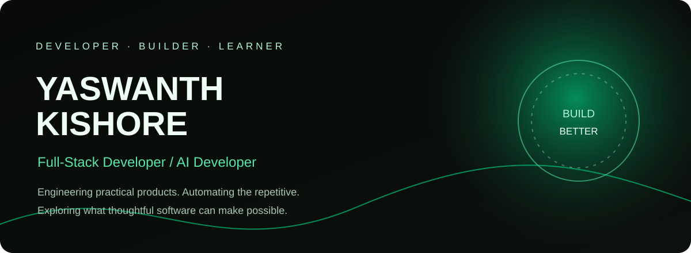
</a>

  

  
  
  

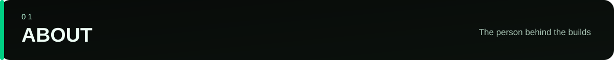
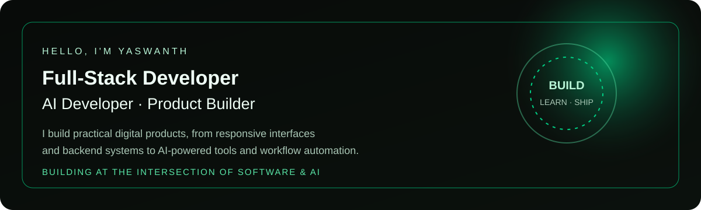

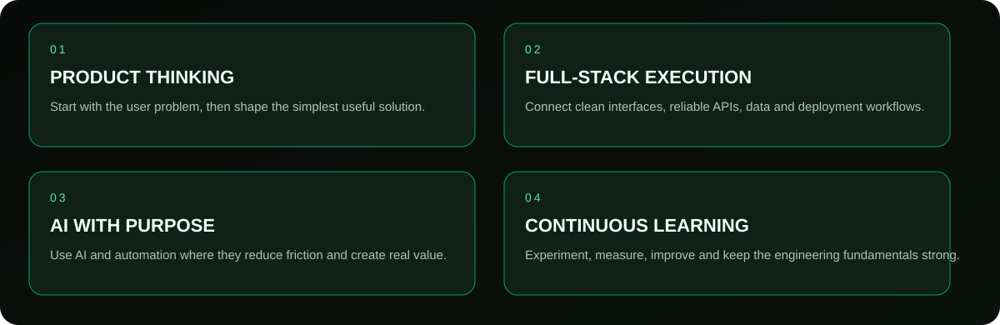

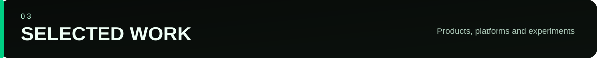

<a href="https://shldrapp.in/">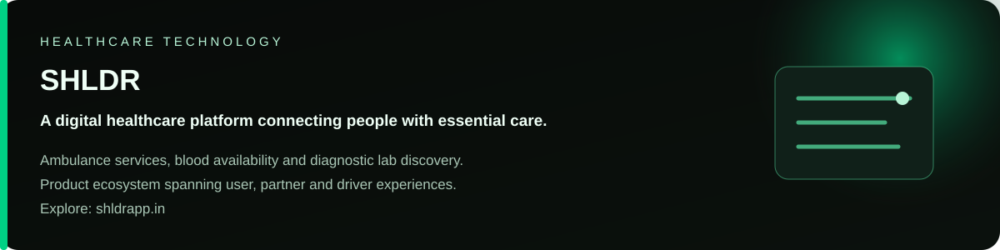</a>

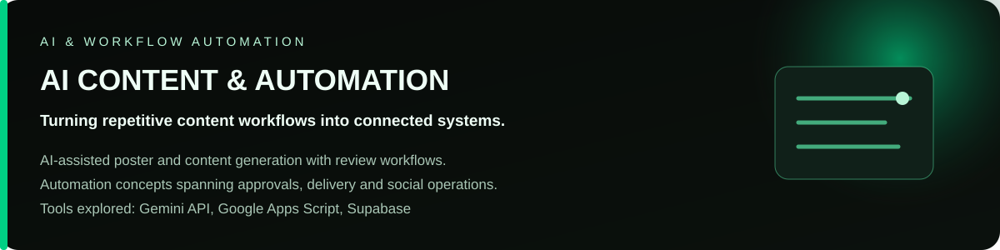

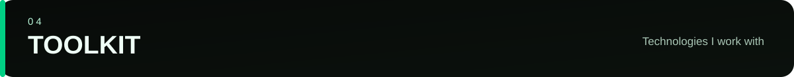

<strong>LANGUAGES & FRONTEND</strong>

  

<strong>BACKEND & FRAMEWORKS</strong>

  

<strong>DATABASES & CLOUD</strong>

  

<strong>TOOLS & AI</strong>

  
   
  
  
  

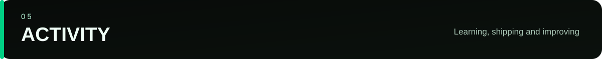

  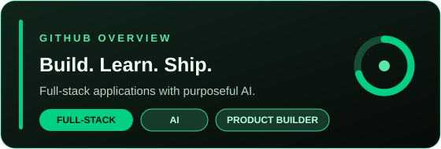
  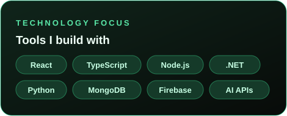

  

  

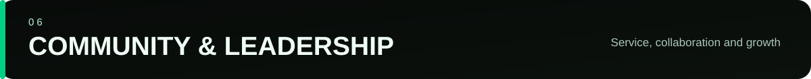
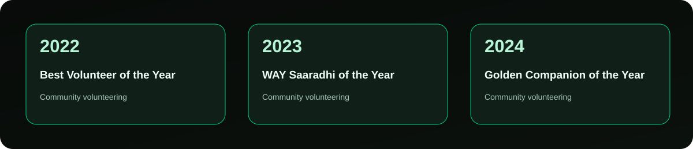

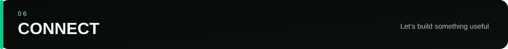

  
  
  

